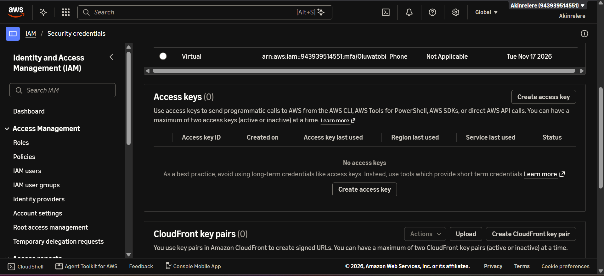
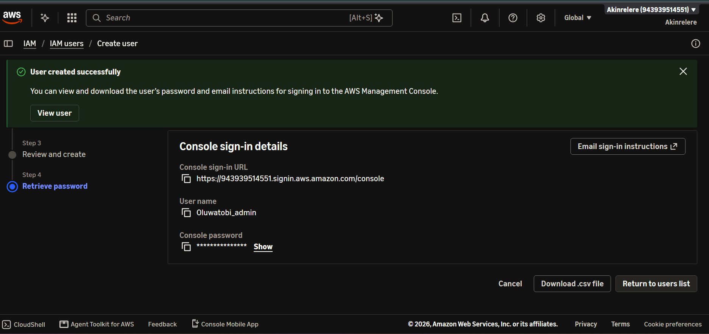
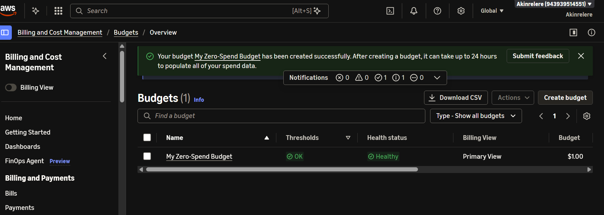

# Bincom Cloud Security Project Report

**Name:** Oluwatobi Akinrelere
**Date:** November 20, 2026
**Project:** Cloud Security Fundamentals — Billing Guardrails, IAM Least-Privilege Hardening & S3 Bucket Security

## 1. Zero-Spend Billing Guardrails & Root Account Hardening
*   **Root MFA:** Enabled Multi-Factor Authentication (Virtual MFA device) on the AWS Root user.
*   **Root Access Keys:** Verified that zero active Root access keys exist.
*   **Daily Admin User:** Created a dedicated IAM user (`Oluwatobi_admin`) with MFA enabled for daily administrative tasks.
*   **Zero-Spend Budget:** Configured an AWS Budget with a $0.01 threshold to alert on any fraction-of-a-cent spending.






## 2. Least-Privilege IAM Policy Engineering & Simulation
*   **Custom Policy:** Authored the `Bincom-S3-ReadOnly-Scoped` policy, allowing `s3:GetObject` and `s3:ListBucket` only for specific bucket ARNs, while explicitly denying `s3:DeleteBucket` and `s3:PutBucketPolicy`.
*   **Policy Simulation:** Used the AWS IAM Policy Simulator with the `oluwatobi-auditor` test user to prove the boundaries.
    *   Proved that `GetObject` is **Allowed**.
    *   Proved that `DeleteBucket` is **Denied**.

**Policy JSON:** [View the JSON file here](./Bincom-S3-ReadOnly-Scoped.json)

Here is the raw JSON:
```json
{
  "Version": "2012-10-17",
  "Statement": [
    {
      "Sid": "AllowReadOnlySpecificBucket",
      "Effect": "Allow",
      "Action": [
        "s3:GetObject",
        "s3:ListBucket"
      ],
      "Resource": [
        "arn:aws:s3:::bincom-onboarding-oluwatobi-*",
        "arn:aws:s3:::bincom-onboarding-oluwatobi-*/*"
      ]
    },
    {
      "Sid": "DenyDeleteAndPolicyChanges",
      "Effect": "Deny",
      "Action": [
        "s3:DeleteBucket",
        "s3:PutBucketPolicy"
      ],
      "Resource": "arn:aws:s3:::bincom-onboarding-oluwatobi-*"
    }
  ]
}
