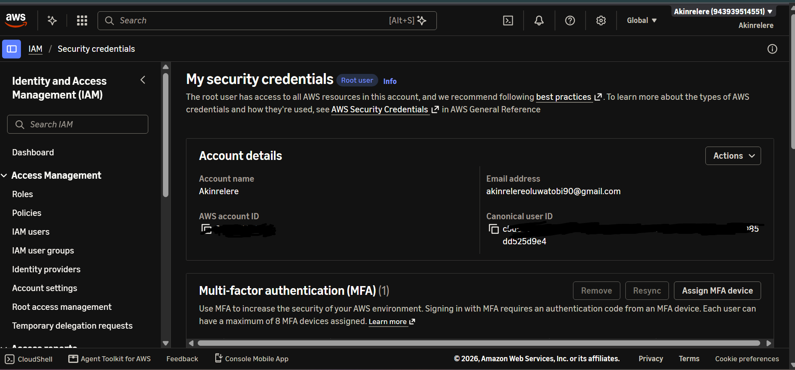
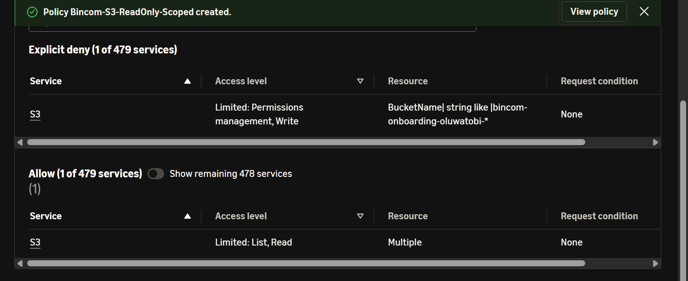
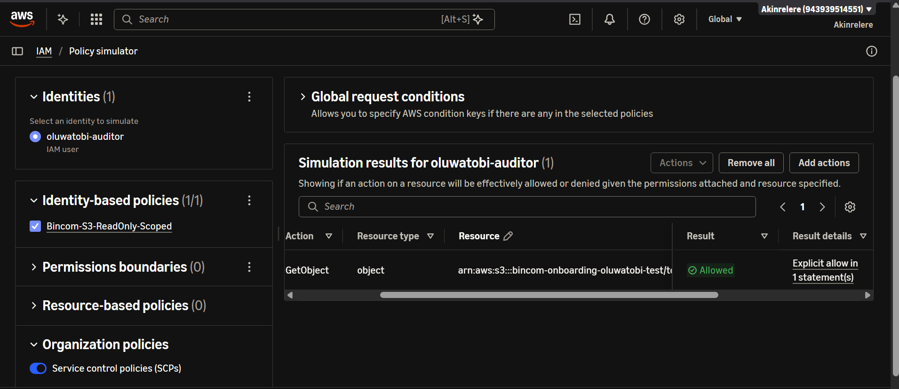
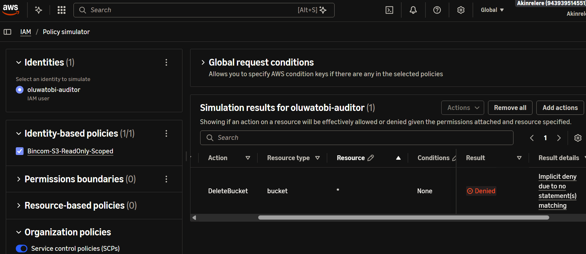
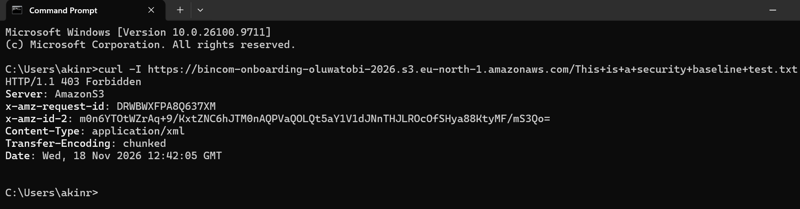
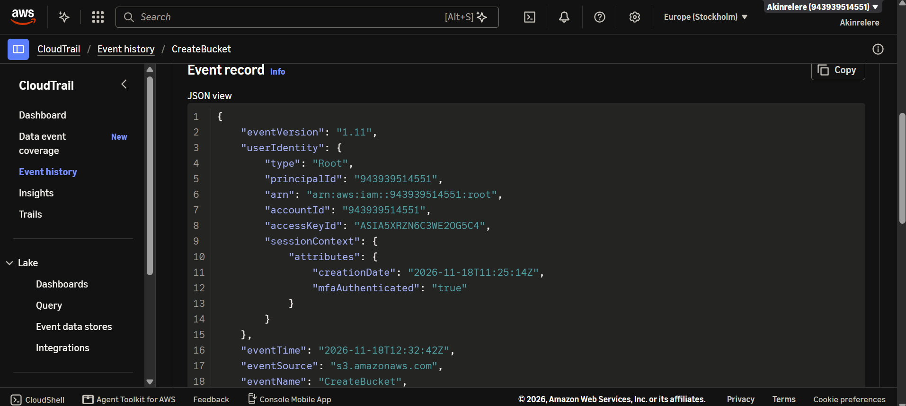
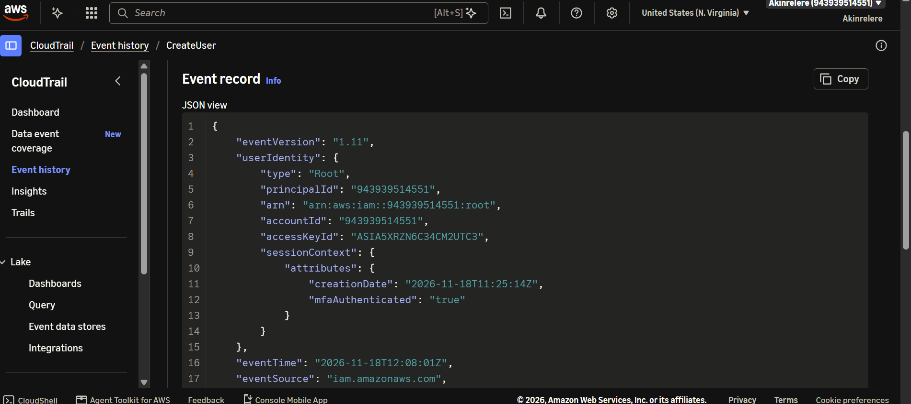
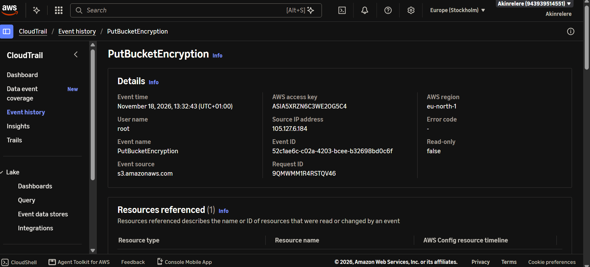
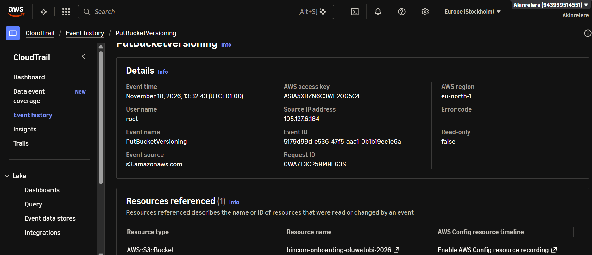

# Bincom Cloud Security Project Report

**Name:** Oluwatobi Akinrelere
**Date:** November 20, 2026
**Project:** Cloud Security Fundamentals — Billing Guardrails, IAM Least-Privilege Hardening & S3 Bucket Security

## 1. Zero-Spend Billing Guardrails & Root Account Hardening
*   **Root MFA:** Enabled Multi-Factor Authentication (Virtual MFA device) on the AWS Root user.
*   **Root Access Keys:** Verified that zero active Root access keys exist.
*   **Daily Admin User:** Created a dedicated IAM user (`Oluwatobi_admin`) with MFA enabled for daily administrative tasks.
*   **Zero-Spend Budget:** Configured an AWS Budget with a $0.01 threshold to alert on any fraction-of-a-cent spending.

## 2. Least-Privilege IAM Policy Engineering & Simulation
*   **Custom Policy:** Authored the `Bincom-S3-ReadOnly-Scoped` policy, allowing `s3:GetObject` and `s3:ListBucket` only for specific bucket ARNs, while explicitly denying `s3:DeleteBucket` and `s3:PutBucketPolicy`.
*   **Policy Simulation:** Used the AWS IAM Policy Simulator with the `oluwatobi-auditor` test user to prove the boundaries.
    *   Proved that `GetObject` is **Allowed**.
    *   Proved that `DeleteBucket` is **Denied**.

Policy JSON: [View the JSON file here](./Bincom-S3-ReadOnly-Scoped.json)

## 3. S3 Bucket Hardening & Public Access Prevention
*   **Bucket Creation:** Created `bincom-onboarding-oluwatobi-2026`.
*   **Security Settings:** Enabled "Block All Public Access" (all 4 checkboxes), Default Encryption (SSE-S3), and Bucket Versioning.
*   **Empirical Verification:** Uploaded a test file (`security-baseline.txt`) and executed a `curl -I` request against the Object URL. The request returned **`HTTP/1.1 403 Forbidden`**, proving public access is securely blocked.

## 4. Control-Plane Audit Log Inspection (AWS CloudTrail)
Inspected the free CloudTrail Event History to verify the control-plane actions taken during this project. The JSON audit records show the identity ARN, source IP address, and timestamps for all configurations.

## 5. Cleanup Verification
*   Deleted the test `security-baseline.txt` object (including all hidden versions).
*   Deleted the `bincom-onboarding-oluwatobi-2026` S3 bucket.
*   Account remains clean with an estimated spend of $0.00.
